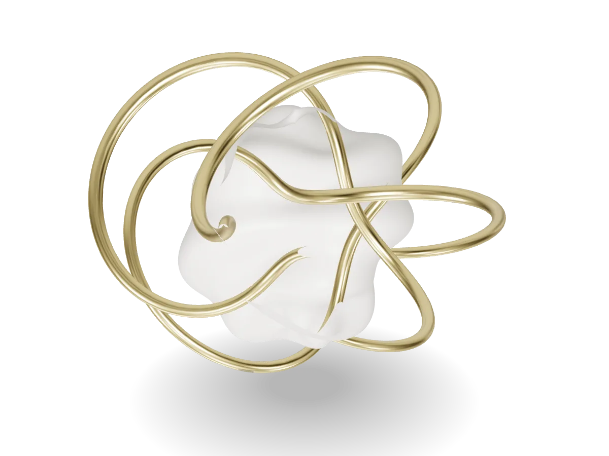

<p align="center">
  
</p>

<h1 align="center">mesh2web</h1>

<p align="center"><strong>Turn any 3D model into a lightweight, beautiful, embeddable web component.</strong></p>

<p align="center">
  <a href="https://pinyi333.github.io/mesh2web/">Website</a> ·
  <a href="https://pinyi333.github.io/mesh2web/studio/">Studio</a> ·
  <a href="#cli">CLI</a> ·
  <a href="#web-model">&lt;web-model&gt;</a> ·
  <a href="README.zh-TW.md">繁體中文</a>
</p>

```
34.0 MB → 556 KB   ·   348,288 → 77,600 triangles   ·   −98%   ·   2.9 s on slow 4G
```
<sub>Measured on <code>test-assets/bad-knot.glb</code> (a deliberately messy export) with the <code>product</code> preset.</sub>

---

Putting 3D on the web fails somewhere along a long chain: **export → optimize → embed → present → interact → maintain**. Each link needs different expertise. mesh2web is one open, self-hostable, framework-free pipeline for the whole chain:

| Package | What it does |
|---|---|
| [`@mesh2web/cli`](packages/cli) | `inspect`, `optimize`, `build --watch`, size/triangle budgets for CI |
| [`@mesh2web/element`](packages/element) | `<web-model>`: poster-first, lazy, adaptive, GSAP-friendly Web Component |
| [`@mesh2web/core`](packages/core) | The pipeline itself (Node + browser), built on glTF-Transform and meshoptimizer |
| [`@mesh2web/presets`](packages/presets) | Optimization presets (`hero`, `product`, `ambient`) and lighting presets |
| [Studio](apps/studio) | Drag-and-drop GUI. Runs entirely in your browser, so models are never uploaded |

## Quick start

```bash
npx @mesh2web/cli optimize robot.glb        # default preset: product
```

```
robot.glb … clean → normals → simplify → fit-budget → textures → lod → compress:meshopt · 2.7s
  Size        34.01 MB → 556.0 KB  -98%
  Triangles   348,288 → 77,600  -78%
  Draw calls  2 → 1
  Load time   2.9 s slow 4G · 543 ms fast 4G
  → robot.glb 556.0 KB · 77,600 tris
  → robot.lod1.glb 352.6 KB · 38,800 tris
  → robot.lod2.glb 231.1 KB · 15,519 tris
  ✓ Within budget
```

Then paste the generated `robot.embed.html`:

```html
<script type="module" src="https://cdn.jsdelivr.net/npm/@mesh2web/element/dist/web-model.js"></script>

<web-model
  src="/3d/robot.glb"
  lod-src="/3d/robot.lod1.glb /3d/robot.lod2.glb"
  poster="/3d/robot.webp"
  alt="A floating robot mascot"
  lighting="studio-soft"
  autorotate
  loading="lazy"
></web-model>
```

<h2 id="cli">CLI</h2>

```bash
npm i -D @mesh2web/cli          # or use npx @mesh2web/cli …

mesh2web inspect  model.glb      # health check: counts, textures, issues + fixes
mesh2web optimize model.glb -p hero --poster
mesh2web init                    # writes mesh2web.config.json
mesh2web build                   # batch-process a folder (exit code 2 if over budget)
mesh2web build --watch           # rebuild on save
mesh2web presets                 # list presets
```

| Flag | |
|---|---|
| `-p, --preset` | `hero` · `product` (default) · `ambient` |
| `-o, --out` | Output directory |
| `--geometry` | `meshopt` (default) · `draco` · `none` |
| `--ratio` / `--no-simplify` | Simplification target (0–1) |
| `--texture-size` / `--texture-format` | e.g. `1024`, `webp` · `jpeg` · `png` · `keep` |
| `--no-lod` | Skip LOD files |
| `--max-size` / `--max-triangles` | Budgets. Over budget exits with code `2` |
| `--no-fit` | Don't auto-simplify further to meet the triangle budget |
| `--poster` | Render `<name>.webp` with headless Chromium (needs `playwright-core`) |
| `--public-path` | URL prefix used in the embed snippet |
| `--json` | Machine-readable output |

**Outputs**: `name.glb`, `name.lodN.glb`, `name.report.json`, `name.report.html` (self-contained before/after report), `name.embed.html` and, with `--poster`, `name.webp`.

**Inputs**: `.glb`, `.gltf`, `.obj` (+ `.mtl`). FBX: export to glTF from Blender (or FBX2glTF) first.

### `mesh2web.config.json`

```json
{
  "input": "assets/3d/src",
  "output": "public/3d",
  "preset": "product",
  "publicPath": "/3d",
  "budget": { "maxSizeKB": 1500, "maxTriangles": 80000 },
  "textures": { "format": "webp", "maxSize": 2048 },
  "lod": [1, 0.5, 0.2],
  "poster": { "width": 1200, "format": "webp" },
  "overrides": { "hero-robot.glb": { "preset": "hero" } }
}
```

### Presets

| Preset | For | Triangle budget | Size budget | Textures | LODs |
|---|---|---|---|---|---|
| `hero` | Above-the-fold visual | 150k | 2.5 MB | ≤ 2048 px WebP | 1, 0.5 |
| `product` | Product viewers | 80k | 1.5 MB | ≤ 2048 px WebP | 1, 0.5, 0.2 |
| `ambient` | Background decoration | 25k | 600 KB | ≤ 1024 px WebP | 1 |

### What the pipeline does

1. **Inspect**: triangles, draw calls, texture sizes and GPU memory, missing normals, non-PBR materials, centimeter scale, Z-up hints, unused data.
2. **Clean**: dedup, flatten, join meshes by material, weld, prune, and add smooth normals where missing.
3. **Simplify**: meshoptimizer with an error bound; then *fit the budget* if still over.
4. **Textures**: resize and re-encode to WebP (via `sharp` in Node, OffscreenCanvas in Studio).
5. **LOD**: simplified variants for weaker devices.
6. **Compress**: `EXT_meshopt_compression` (default) or Draco.
7. **Report**: JSON + HTML with before/after and estimated load times.

<h2 id="web-model">&lt;web-model&gt;</h2>

```bash
npm i @mesh2web/element
```
```js
import '@mesh2web/element'; // registers <web-model>
```

The element shell is **4 KB gzip**. three.js (≈170 KB gzip) loads as a separate chunk only when a model is about to be shown.

| Attribute | Default | |
|---|---|---|
| `src` | | GLB / glTF URL |
| `lod-src` | | Space-separated lower-detail variants, highest first. Picked by device tier |
| `poster` | | Shown immediately; the model fades in over it |
| `alt` | | Becomes `aria-label` (`role="img"`) |
| `loading` | `lazy` | `lazy` · `eager` · `interaction` (shows a "View in 3D" button) |
| `lighting` | `studio-soft` | `studio-soft` · `studio-hard` · `outdoor` · `neon` · `flat` |
| `controls` | `orbit` | `orbit` · `none` |
| `gesture` | `page-first` | `page-first`: one finger scrolls the page, a horizontal swipe or two fingers rotate the model, and the wheel zooms only with Ctrl/⌘. `model-first`: all input goes to the model |
| `autorotate`, `autorotate-speed` | off, `12` | Degrees per second. Disabled under `prefers-reduced-motion` |
| `camera-orbit` | `0 75 3.7` | `azimuth polar distance` (degrees, degrees, model radii) |
| `exposure` | per preset | Tone-mapping exposure |
| `shadow` | on | `none` removes the contact shadow |
| `quality` | `auto` | `auto` · `high` · `medium` · `low` |
| `disable-zoom` | | |
| `autoplay` | | Play the first animation clip |
| `draco-decoder-path` | gstatic CDN | Self-host the Draco decoder |

**Properties and methods**: `ready` (Promise), `camera` `{ azimuth, polar, distance, fov }`, `animation` `{ progress, play(), pause(), duration, names }`, `exposure`, `scene`, `renderer`, `quality`, `reducedMotion`, `load()`, `invalidate()`, `renderOnce()`, `snapshot(type, quality)`.

**Events**: `load`, `progress`, `error` (`detail.code`: `no-webgl` · `load-failed`), `quality-change`.

**Styling**: `--web-model-aspect-ratio` (default `4 / 3`), `--web-model-accent`, `--web-model-poster-fit`, `--web-model-fade`, plus `::part(stage | poster | canvas | prompt | progress)`.

**Built-in behavior**: renders only when something changes, pauses off-screen and in hidden tabs, lowers pixel ratio when FPS stays under 30, keeps the poster visible without WebGL, rotates with the arrow keys (+/− zoom), and reserves its box so nothing shifts.

### Scroll stories with GSAP

Every camera value is a plain number, so GSAP tweens it directly:

```js
import { gsap } from 'gsap';
import { ScrollTrigger } from 'gsap/ScrollTrigger';
gsap.registerPlugin(ScrollTrigger);

const model = document.querySelector('web-model');
await model.ready;

gsap.timeline({ scrollTrigger: { trigger: '#story', start: 'top top', end: '+=2000', scrub: true, pin: true } })
  .to(model.camera, { azimuth: 180, distance: 4 })
  .to(model.animation, { progress: 1 }, 0)
  .to(model, { exposure: 1.4 }, 0.5);
```

Or use the optional bridge, which waits for `ready` and respects reduced motion:

```js
import { scrollModel } from '@mesh2web/element/gsap';
scrollModel(gsap, model, {
  scrollTrigger: { trigger: '#story', start: 'top top', end: '+=2000', scrub: true, pin: true },
  steps: [{ camera: { azimuth: 180, distance: 4 } }, { animation: { progress: 1 }, at: 0 }, { exposure: 1.4, at: 0.5 }],
});
```

### Frameworks

`<web-model>` is a standard Custom Element: it works in React, Vue, Svelte and Astro without a wrapper. See [`examples/with-react`](examples/with-react).

## Studio

[pinyi333.github.io/mesh2web/studio](https://pinyi333.github.io/mesh2web/studio/): drop a GLB, glTF (with its files) or OBJ. Studio runs a health check, lets you pick a preset or fine-tune it, and compares before and after in a split view with a synced camera. It exports a zip with the GLB, LODs, a poster, the embed code and a report. Everything runs in a Web Worker on your machine.

## Examples

| | |
|---|---|
| [`examples/basic`](examples/basic) | Minimal embed |
| [`examples/scroll-story-gsap`](examples/scroll-story-gsap) | Pinned ScrollTrigger story via the GSAP bridge |
| [`examples/product-viewer`](examples/product-viewer) | Color variants and camera views using the JS API |
| [`examples/with-react`](examples/with-react) | Using the element from React |

## Develop

```bash
npm install
npm run assets     # generate CC0 procedural test models
npm run build      # bundle the element, Studio's worker core, docs vendor files
npm test           # unit tests (vitest)
npm run test:e2e   # headless Chromium smoke tests (needs a Chromium for playwright-core)
npm run dev        # http://127.0.0.1:5173/apps/docs/
```

See [CONTRIBUTING.md](CONTRIBUTING.md). Good first issues: new presets, translations, examples.

## Compared to…

- **glTF-Transform / gltfpack**: excellent, and mesh2web uses them underneath. mesh2web adds presets, budgets, reports, a GUI and the runtime.
- **`<model-viewer>`**: great for product AR. mesh2web focuses on the optimization pipeline and on scroll and GSAP storytelling.
- **Spline / Sketchfab embeds**: mesh2web takes their GLB exports and ships them without a heavy runtime, watermark or tracking.

## Roadmap

- [x] CLI: inspect, optimize, presets, budgets, reports, LODs, watch mode, posters
- [x] `<web-model>`: poster, lazy loading, adaptive quality, lighting presets, gestures, a11y, GSAP bridge
- [x] Studio: in-browser optimization, split compare, zip export
- [ ] KTX2 / Basis texture compression
- [ ] USDZ output for iOS AR Quick Look
- [ ] SSIM visual-diff warnings for over-simplification
- [ ] WebGPU renderer, Blender add-on, auto-repair for AI-generated meshes

## License

[MIT](LICENSE). Test models are generated from code (CC0). Built on [three.js](https://threejs.org), [glTF-Transform](https://gltf-transform.dev) and [meshoptimizer](https://github.com/zeux/meshoptimizer).
