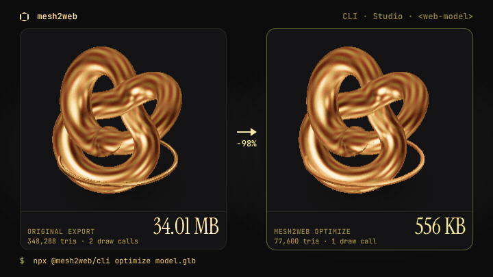

<p align="center">
  
</p>

<h1 align="center">mesh2web</h1>

<p align="center"><strong>把 34 MB 的 3D 模型變成 556 KB、一行 HTML 就能嵌入的網頁元件。</strong></p>

<p align="center">
  <a href="https://www.npmjs.com/package/@mesh2web/cli"></a>
  <a href="https://www.npmjs.com/package/@mesh2web/element"></a>
  <a href="https://github.com/pinyi333/mesh2web/actions/workflows/ci.yml"></a>
  <a href="LICENSE"></a>
</p>

<p align="center">
  <a href="https://pinyi333.github.io/mesh2web/">官網</a> ·
  <a href="https://pinyi333.github.io/mesh2web/studio/">Studio</a> ·
  <a href="#cli">CLI</a> ·
  <a href="#web-model">&lt;web-model&gt;</a> ·
  <a href="docs/integrations.zh-TW.md">整合範例</a> ·
  <a href="README.md">English</a>
</p>

```
34.0 MB → 556 KB   ·   348,288 → 77,600 面   ·   −98%   ·   慢速 4G 約 2.9 秒
```
<sub>以 <code>test-assets/bad-knot.glb</code>（刻意做髒的匯出檔）搭配 <code>product</code> preset 實測。全部在本機處理，模型不會上傳。</sub>

## 30 秒上手

**1. 優化**（不用安裝）：

```bash
npx @mesh2web/cli optimize model.glb
```

**2. 嵌入**（一個 script、一個元素）：

```html
<script type="module" src="https://cdn.jsdelivr.net/npm/@mesh2web/element@0.1/dist/web-model.js"></script>
<web-model src="model.glb" alt="描述你的模型" autorotate></web-model>
```

這樣就完成了：poster 優先的延遲載入、自適應品質與無障礙預設都已內建。想用介面操作？把檔案拖進 [Studio](https://pinyi333.github.io/mesh2web/studio/) 即可。

---

把 3D 放上網路，失敗點分散在「匯出 → 優化 → 嵌入 → 呈現 → 互動 → 維護」整條鏈上，每一環需要的專業都不同。mesh2web 用一條**開源、可自架、不綁框架**的流程，把整條鏈串起來：

| 套件 | 功能 |
|---|---|
| [`@mesh2web/cli`](packages/cli) | `inspect`、`optimize`、`build --watch`，以及可接 CI 的體積與面數預算 |
| [`@mesh2web/element`](packages/element) | `<web-model>`：poster 優先、延遲載入、自適應品質、為 GSAP 設計的 Web Component |
| [`@mesh2web/core`](packages/core) | 優化管線本體（Node 與瀏覽器共用），建立在 glTF-Transform 與 meshoptimizer 之上 |
| [`@mesh2web/presets`](packages/presets) | 優化 preset（`hero`、`product`、`ambient`）與燈光 preset |
| [Studio](apps/studio) | 拖曳即用的網頁 GUI，全部在瀏覽器本地處理，模型不會上傳 |

## 完整流程

```bash
npx @mesh2web/cli optimize robot.glb        # 預設 preset：product
```

```
robot.glb … clean → normals → simplify → fit-budget → textures → lod → compress:meshopt · 2.7s
  Size        34.01 MB → 556.0 KB  -98%
  Triangles   348,288 → 77,600  -78%
  Draw calls  2 → 1
  Load time   2.9 s slow 4G · 543 ms fast 4G
  → robot.glb 556.0 KB · 77,600 tris
  → robot.lod1.glb 352.6 KB · 38,800 tris
  → robot.lod2.glb 231.1 KB · 15,519 tris
  ✓ Within budget
```

接著把產出的 `robot.embed.html` 貼進網頁：

```html
<script type="module" src="https://cdn.jsdelivr.net/npm/@mesh2web/element@0.1/dist/web-model.js"></script>

<web-model
  src="/3d/robot.glb"
  lod-src="/3d/robot.lod1.glb /3d/robot.lod2.glb"
  poster="/3d/robot.webp"
  alt="漂浮的機器人吉祥物"
  lighting="studio-soft"
  autorotate
  loading="lazy"
></web-model>
```

<h2 id="cli">CLI</h2>

```bash
npm i -D @mesh2web/cli          # 或直接用 npx @mesh2web/cli …

mesh2web inspect  model.glb      # 健檢：面數、貼圖、問題與修正建議
mesh2web optimize model.glb -p hero --poster
mesh2web init                    # 建立 mesh2web.config.json
mesh2web build                   # 批次處理整個資料夾（超過預算時結束碼為 2）
mesh2web build --watch           # 存檔就自動重建
mesh2web presets                 # 列出所有 preset
mesh2web presets --json          # 以 JSON 輸出完整 preset 定義，方便給腳本使用
```

| 參數 | |
|---|---|
| `-p, --preset` | `hero` · `product`（預設）· `ambient` |
| `-o, --out` | 輸出資料夾 |
| `--geometry` | `meshopt`（預設）· `draco` · `none` |
| `--ratio` / `--no-simplify` | 減面目標比例（0–1）／不減面 |
| `--texture-size` / `--texture-format` | 例如 `1024`；`webp` · `jpeg` · `png` · `ktx2` · `keep` |
| `--texture-mode` | 只用於 KTX2：`auto`（預設：顏色貼圖用 ETC1S、法線貼圖用 UASTC）· `etc1s` · `uastc` |
| `--no-lod` | 不產生 LOD 檔 |
| `--max-size` / `--max-triangles` / `--max-texture-memory` | 預算（KB、面數、貼圖 GPU 記憶體 MB）。超出時結束碼為 `2` |
| `--no-fit` | 超出面數預算時，不自動再減面 |
| `--ar` | 另外輸出給 Android Scene Viewer 的 `name.ar.glb`、給 iOS Quick Look 的 `name.usdz`（需要 `playwright-core`），並在嵌入碼加上 `ar` |
| `--poster` | 用無頭 Chromium 輸出 `<name>.webp`（需要 `playwright-core`） |
| `--public-path` | 嵌入碼裡使用的網址前綴 |
| `--json` | 輸出機器可讀的 JSON |

**輸出檔**：`name.glb`、`name.lodN.glb`、`name.report.json`、`name.report.html`（單檔、可直接開的處理前後報告）、`name.embed.html`；加上 `--poster` 時還有 `name.webp`，加上 `--ar` 時還有 `name.ar.glb` 與 `name.usdz`。

**支援輸入**：`.glb`、`.gltf`、`.obj`（含 `.mtl`）。FBX 請先用 Blender 或 FBX2glTF 轉成 glTF。

### `mesh2web.config.json`

```json
{
  "input": "assets/3d/src",
  "output": "public/3d",
  "preset": "product",
  "publicPath": "/3d",
  "budget": { "maxSizeKB": 1500, "maxTriangles": 80000, "maxTextureMemoryMB": 16 },
  "textures": { "format": "ktx2", "maxSize": 2048 },
  "lod": [1, 0.5, 0.2],
  "poster": { "width": 1200, "format": "webp" },
  "ar": true,
  "overrides": { "hero-robot.glb": { "preset": "hero" } }
}
```

### Presets

| Preset | 用途 | 面數預算 | 體積預算 | 貼圖 | LOD |
|---|---|---|---|---|---|
| `hero` | 首屏主視覺 | 15 萬 | 2.5 MB | ≤ 2048 px WebP | 1, 0.5 |
| `product` | 產品展示 | 8 萬 | 1.5 MB | ≤ 2048 px WebP | 1, 0.5, 0.2 |
| `ambient` | 背景裝飾 | 2.5 萬 | 600 KB | ≤ 1024 px WebP | 1 |

### 管線做了什麼

1. **健檢**：面數、draw call、貼圖尺寸與 GPU 記憶體、缺法線、非 PBR 材質、公分單位、Z 軸朝上、未使用的資料。
2. **清理**：去重、攤平階層、依材質合併網格、焊接頂點、清除未使用資源，缺法線時補上平滑法線。
3. **減面**：用 meshoptimizer 在誤差上限內減面；仍超出預算時再自動*擠進預算*。
4. **貼圖**：縮放並重新編碼成 WebP（Node 用 `sharp`，Studio 用 OffscreenCanvas），或轉成 **KTX2**（Basis Universal），讓貼圖在 GPU 上維持壓縮。詳見 [KTX2 貼圖](#ktx2)。
5. **LOD**：為效能較弱的裝置產生低面數版本。
6. **壓縮**：`EXT_meshopt_compression`（預設）或 Draco。
7. **報告**：JSON 與 HTML，含處理前後對照、貼圖 GPU 記憶體與預估載入時間。

<h3 id="ktx2">KTX2 貼圖</h3>

WebP、JPEG 下載很小，但到了 GPU 會解成原始 RGBA：一張 2048 px 貼圖約佔 21 MB 顯示記憶體。KTX2 在 GPU 上仍保持壓縮，大約少 4 倍，手機比較不會掉幀或因記憶體不足重新載入分頁。

```bash
mesh2web optimize robot.glb --texture-format ktx2 --max-texture-memory 16
```

以產生的 `bad-knot.glb`（35.7 MB，一張 4096 px PNG）、`product` preset 實測：

| | WebP（預設） | KTX2 |
|---|---|---|
| 檔案大小 | 556 KB | 926 KB |
| 貼圖 GPU 記憶體 | 21.3 MB | **5.3 MB** |
| 面數／draw call | 77,600／1 | 77,600／1 |

KTX2 的下載量比 WebP 稍大，適合貼圖大、或同一頁有多個模型的情況。顏色貼圖用 ETC1S（sRGB），法線貼圖用 UASTC 以免出現色塊。`<web-model>` 只有在模型用到 KTX2 時才載入 Basis 轉碼器（壓縮後約 250 KB，預設來自 jsDelivr）。編碼使用 Basis Universal 編碼器（Apache-2.0），透過 [`ktx2-encoder`](https://github.com/gz65555/ktx2-encoder)（MIT）在 Node 與瀏覽器都能執行。

<h2 id="web-model">&lt;web-model&gt;</h2>

```bash
npm i @mesh2web/element
```
```js
import '@mesh2web/element'; // 註冊 <web-model>
```

也可以直接從 CDN 載入，不需要打包工具（建議鎖定測試過的版本）：

```html
<!-- jsDelivr -->
<script type="module" src="https://cdn.jsdelivr.net/npm/@mesh2web/element@0.1/dist/web-model.js"></script>
<!-- 或 unpkg -->
<script type="module" src="https://unpkg.com/@mesh2web/element@0.1/dist/web-model.js"></script>
```

元件本體只有 **5 KB gzip**。three.js（約 170 KB gzip）拆成獨立 chunk，只在模型即將出現時才載入。

| 屬性 | 預設 | 說明 |
|---|---|---|
| `src` | | GLB／glTF 網址 |
| `lod-src` | | 以空白分隔的低面數版本，精細的在前，依裝置等級挑選 |
| `poster` | | 立即顯示的靜態圖，模型準備好後淡入 |
| `alt` | | 轉成 `aria-label`（`role="img"`） |
| `loading` | `lazy` | `lazy` · `eager` · `interaction`（顯示「View in 3D」按鈕，點了才載入） |
| `lighting` | `studio-soft` | `studio-soft` · `studio-hard` · `outdoor` · `neon` · `flat` |
| `controls` | `orbit` | `orbit` · `none` |
| `gesture` | `page-first` | `page-first`：單指留給頁面滾動，水平滑動或雙指旋轉模型，滾輪需按 Ctrl/⌘ 才縮放。`model-first`：所有操作都給模型 |
| `autorotate`、`autorotate-speed` | 關閉、`12` | 每秒旋轉角度。使用者開啟 `prefers-reduced-motion` 時自動停用 |
| `camera-orbit` | `0 75 3.7` | `方位角 俯仰角 距離`（度、度、模型半徑倍數） |
| `exposure` | 依燈光 preset | 色調映射曝光值 |
| `shadow` | 開啟 | 設為 `none` 移除接觸陰影 |
| `quality` | `auto` | `auto` · `high` · `medium` · `low` |
| `disable-zoom` | | 停用縮放 |
| `autoplay` | | 自動播放第一段動畫 |
| `draco-decoder-path` | gstatic CDN | 自架 Draco 解碼器的路徑 |
| `ktx2-transcoder-path` | jsDelivr（three.js `libs/basis/`） | 自架 KTX2 轉碼器的路徑。`WebModel.ktx2TranscoderPath` 可一次設定所有元件 |
| `ar` | | 在能開 AR 的手機與平板上顯示「View in your space」按鈕 |
| `ar-src` | `src` | 交給 Android Scene Viewer 的 GLB（請用 `--ar` 的輸出：不含 Meshopt 與 KTX2） |
| `ios-src` | 需要時自動產生 | 給 iOS AR Quick Look 的 USDZ。沒給的話，元件會在瀏覽器裡把已載入的模型轉成 USDZ |
| `ar-placement` | `floor` | `floor`（地面）· `wall`（牆面） |
| `ar-scale` | `auto` | `auto` 允許在 AR 中縮放，`fixed` 維持真實尺寸 |

**屬性與方法**：`ready`（Promise）、`camera` `{ azimuth, polar, distance, fov }`、`animation` `{ progress, play(), pause(), duration, names }`、`exposure`、`scene`、`renderer`、`quality`、`reducedMotion`、`load()`、`invalidate()`、`renderOnce()`、`snapshot(type, quality)`、`arMode`（`quick-look` · `scene-viewer` · `null`）、`canActivateAR`、`activateAR()`、`exportUSDZ()`。

**事件**：`load`、`progress`、`error`（`detail.code`：`no-webgl` · `load-failed`）、`quality-change`、`ar-status`（`session-started` · `failed`；取消事件即可自行開啟 `detail.url`）。

**樣式**：`--web-model-aspect-ratio`（預設 `4 / 3`）、`--web-model-accent`、`--web-model-poster-fit`、`--web-model-fade`，以及 `::part(stage | poster | canvas | prompt | ar-button | progress)`，並可用 `slot="ar-button"` 替換 AR 按鈕內容。

**內建行為**：畫面有變化才重繪；離開可視範圍或分頁隱藏時暫停；FPS 持續低於 30 時自動降低像素比；沒有 WebGL 時保留 poster；可用方向鍵旋轉（+／− 縮放）；預先保留版面空間，不會造成版面位移。

<h3 id="ar">AR</h3>

```bash
mesh2web optimize chair.glb --ar
```

```html
<web-model src="chair.glb" ar ar-src="chair.ar.glb" ios-src="chair.usdz" alt="橡木椅"></web-model>
```

在 Android 上按鈕會開啟 Google Scene Viewer，在 iPhone、iPad 上開啟 AR Quick Look；桌機上不顯示。兩者都是手機內建的 AR 檢視器，頁面裡不需要 WebXR 程式碼，也沒有額外下載。`chair.ar.glb` 使用 Draco 與 PNG／JPEG，因為 Scene Viewer 不支援 Meshopt 與 KTX2。`.usdz` 和元件在瀏覽器裡用的是同一個 three.js 轉換器，所以 `ios-src` 可以省略。

### 搭配 GSAP 做滾動敘事

相機參數都是純數字，GSAP 可以直接補間：

```js
import { gsap } from 'gsap';
import { ScrollTrigger } from 'gsap/ScrollTrigger';
gsap.registerPlugin(ScrollTrigger);

const model = document.querySelector('web-model');
await model.ready;

gsap.timeline({ scrollTrigger: { trigger: '#story', start: 'top top', end: '+=2000', scrub: true, pin: true } })
  .to(model.camera, { azimuth: 180, distance: 4 })
  .to(model.animation, { progress: 1 }, 0)
  .to(model, { exposure: 1.4 }, 0.5);
```

也可以用選配的 bridge，它會等 `ready`，並尊重減少動態的設定：

```js
import { scrollModel } from '@mesh2web/element/gsap';
scrollModel(gsap, model, {
  scrollTrigger: { trigger: '#story', start: 'top top', end: '+=2000', scrub: true, pin: true },
  steps: [{ camera: { azimuth: 180, distance: 4 } }, { animation: { progress: 1 }, at: 0 }, { exposure: 1.4, at: 0.5 }],
});
```

### 框架與建站工具

`<web-model>` 是標準 Custom Element，在 React、Vue、Svelte、Astro 裡不需包裝就能用，範例見 [`examples/with-react`](examples/with-react)。

**Three.js**、**Webflow**、**Framer**、**WordPress** 的逐步教學請見 [docs/integrations.zh-TW.md](docs/integrations.zh-TW.md)。

## Studio

[pinyi333.github.io/mesh2web/studio](https://pinyi333.github.io/mesh2web/studio/)：拖入 GLB、glTF（連同 .bin 與貼圖）或 OBJ。Studio 會做健檢，讓你選 preset 或微調參數，並以同步相機的左右分割畫面比對處理前後。最後匯出 zip，內含 GLB、LOD、poster、嵌入碼和報告。在「微調」裡可以把貼圖改成 KTX2，也可以把 AR 檔（`.ar.glb` 與 `.usdz`）一起加進 zip。所有處理都在你電腦上的 Web Worker 完成。

## 範例

| | |
|---|---|
| [`examples/basic`](examples/basic) | 最簡單的嵌入 |
| [`examples/ar`](examples/ar) | 在 Android 與 iOS 上「View in your space」 |
| [`examples/scroll-story-gsap`](examples/scroll-story-gsap) | 透過 GSAP bridge 做釘選式 ScrollTrigger 滾動敘事 |
| [`examples/product-viewer`](examples/product-viewer) | 用 JS API 切換顏色款式與相機視角 |
| [`examples/with-react`](examples/with-react) | 在 React 裡使用元件 |

## 開發

```bash
npm install
npm run assets     # 產生 CC0 程序化測試模型
npm run build      # 打包元件、Studio 用的 core、文件站相依檔
npm test           # 單元測試（vitest）
npm run test:e2e   # 無頭 Chromium 測試，含 KTX2 與 AR（playwright-core 需要可用的 Chromium）
npm run dev        # http://127.0.0.1:5173/apps/docs/
npm run media      # 重新產生 README 動圖與社群預覽圖（需要 ffmpeg）
```

歡迎貢獻，請見 [CONTRIBUTING.md](CONTRIBUTING.md)。不知道從哪開始？可以看標記為 [`good first issue`](https://github.com/pinyi333/mesh2web/labels/good%20first%20issue) 的題目。

## 與同類工具比較

mesh2web 建立在 glTF-Transform 與 meshoptimizer 之上，和 `<model-viewer>` 是互補而非取代。

| | mesh2web | glTF-Transform / gltfpack | `<model-viewer>` |
|---|---|---|---|
| 減面、壓縮、縮放貼圖 | ✅ 有 preset | ✅ 低階參數 | — |
| KTX2 貼圖 | ✅ `--texture-format ktx2`，瀏覽器也能轉 | ✅（glTF-Transform 需另裝 `toktx`） | 只能讀取 |
| 體積／面數／GPU 記憶體預算，超標讓 CI 失敗 | ✅ 結束碼 `2` | — | — |
| 處理前後報告（HTML + JSON） | ✅ | 僅統計 | — |
| 模型不離開本機的圖形介面 | ✅ Studio | — | 線上編輯器 |
| 可嵌入的檢視元件 | ✅ `<web-model>` | — | ✅ |
| poster 優先延遲載入、自適應品質、LOD | ✅ | — | poster 與延遲載入 |
| 相機參數是純數字，可直接給 GSAP／滾動敘事 | ✅ | — | 屬性字串 |
| AR（Scene Viewer、Quick Look） | ✅ `ar` 屬性，`--ar` 輸出 AR 用 GLB 與 USDZ | — | ✅（另有 WebXR） |

**選 mesh2web**：想用一套工具從髒的匯出檔一路做到快速、可滾動動畫的嵌入，AR 檔也在同一步產生。**選 `<model-viewer>`**：需要在頁面內執行 WebXR AR。**直接用 glTF-Transform**：你在寫自己的管線。

## 路線圖

- [x] CLI：健檢、優化、preset、預算、報告、LOD、watch 模式、poster
- [x] `<web-model>`：poster、延遲載入、自適應品質、燈光 preset、手勢、無障礙、GSAP bridge
- [x] Studio：瀏覽器內優化、分割對照、zip 匯出
- [x] KTX2／Basis 貼圖壓縮、貼圖 GPU 記憶體預算
- [x] AR：Scene Viewer 與 Quick Look，輸出 USDZ
- [x] Studio 加上 KTX2 與 AR 選項
- [ ] 頁面內 WebXR AR
- [ ] 過度減面時以 SSIM 視覺差異提出警告
- [ ] WebGPU 渲染器、Blender 外掛、AI 生成網格的自動修復

## 授權

[MIT](LICENSE)。測試模型皆由程式產生（CC0）。建立在 [three.js](https://threejs.org)、[glTF-Transform](https://gltf-transform.dev)、[meshoptimizer](https://github.com/zeux/meshoptimizer) 與 [ktx2-encoder](https://github.com/gz65555/ktx2-encoder)（MIT，內含 Apache-2.0 授權的 [Basis Universal](https://github.com/BinomialLLC/basis_universal) 編碼器）之上。
